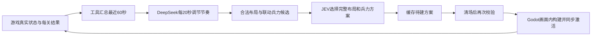

# 无尽远征：关卡生成审计与本轮优化

日期：2026-09-21。范围：Harness 的关卡生成与引擎副本适配。没有另外建立战斗控制器；固定演练和无尽远征继续使用共享战斗 Harness。

## 结论

方向是可行的：设计者制作有意图的地形、路线、掩体与部署槽，DeepSeek 根据真实战况调节节奏，JEV 从合法组合中选择下一关。原来的问题是“组合数量”被当成“体验差异”，而配兵、预生成和结果反馈没有形成完整约束。

不能仅凭这轮几何测试声称战术变聪明、关卡更有趣或玩家能力已被识别。

## 原问题与改动

| 问题 | 原因 | 本轮落实 |
|---|---|---|
| 3 人又补 2 人，却只有 2 个敌人 | 友军与敌人数是两个独立选择，规则允许失衡组合 | JEV 选完整兵力方案；完整三人队不自动扩编；按补员后的数量与可观测血量共同约束守军 |
| “48 种”仍很像 | 只有三个结构族，位置变化小，通常只有两块沙袋和两件道具 | 四个结构族，64 个参数组合；新增双庭院偏置破口；并列/纵深防线真实分层，增加防守沙袋，扩大内外槽差异 |
| 敌人少、站位层次少 | 只有三个部署槽 | 每布局六个可验证部署槽，模型可选 2–6 个守军，整段同步激活，不在战斗中凭空刷到眼前 |
| 清场后仍等待模型 | 已备好关卡也被刷新中的 future 挡住 | 提交与后台刷新解耦；有效缓存直接交引擎；迟到结果不能重复提交 |
| 预生成的配兵可能过期 | 只验证场景版本，不验证清场后的实际队伍 | 返回时和提交时重新验证兵力方案；失效时明确丢弃并重选，不暗改模型决定 |
| 调节依据不可靠 | 压力样本包含尸体；全场射击量被当作主要反馈；施工记录不是战斗结果 | 按阵营统计存活人数、血量、已观测死亡；压力排除死者；保存每关真实耗时、补员及双方结果 |
| “能放进去”不等于可玩 | 原验证对脚印、额外部署点覆盖不全 | 检查地板并集完整支撑、部署间距、全部六槽连通、施工占用；落地前再校验 |
| 界面仍显示到位 1/0 | 遗留出口集合目标 | HUD 改为剩余守军，清场即完成 |

64 是参数组合数，**不是 64 个独立手工关卡**。四族分别是：收窄后展开、转角走廊、双路汇合、双庭院突破。JEV 一次看到最多八个兼容组合，优先保留结构和防线差异，换书堆/木箱仅算很小的变化。

## 分工与上下文

- DeepSeek：阵营人数/血量/压力、最近一分钟趋势、当前清理进展、最近四关的真实结算、旧节奏目标。保留激素平滑，每次变化最多 0.2。不是每帧生成。
- JEV：宏观方向、精简趋势、最近两关结果、最多八个有效布局组合、联动兵力方案。不传碰撞盒与逐帧坐标。
- Harness：候选筛选、模型调用、预生成缓存、版本和兵力校验、日志与失败状态。清场缺缓存时可尽快准备，但仍保留五秒请求保护间隔。
- 引擎：位置、碰撞、通路、真实生成和清场判定。施工成功与战斗通关分别记录。

正常刷新是每 20 秒一次。清场已有合法缓存时不等刷新结束；没有缓存、方案失效或模型请求未完成时，仍可能等待。日志新增清场到提交的游戏时间差，后续实战应测其分布，不能现在宣称零等待。

## 兵力规则示例

以下是调参规则，不是胜率模型，也不是玩家实力判定。

| 清场时绿军 | 可选方案示例 |
|---|---|
| 3 人健康，常规 | 不补员，下一关 3 名守军 |
| 3 人健康，高潮 | 不补员，3 或 4 名守军 |
| 仅剩 1 人健康，常规 | 可选不补员/补 1/补 2；补至 3 人时对应 3 名守军 |
| 5 人健康 | 舒缓为 4–5 名守军；常规 5 名；高潮 5–6 名 |
| 伤势很重 | 可提供更轻的遭遇；因此不机械强制敌我人数相等 |

当前基础编制 3，友军容量 5，每关可补 0–2，守军槽容量 6。未知最大血量时按人数，不擅自判定伤势折扣。坦克未加入候选：现有绿军全步枪，原生目标选择不让步枪/SMG正常承担反坦克任务，无尽模式也没有专门坦克规划。先设计反装甲编队、宽通路和部署槽，再开放坦克遭遇。

## 联网参考及具体取舍

1. [Valve / Michael Booth：The AI Systems of Left 4 Dead，2009](https://steamcdn-a.akamaihd.net/apps/valve/2009/ai_systems_of_l4d_mike_booth.pdf)：参考升温、高潮、舒缓的节奏控制，以及设计者预设位置再由导演选择的做法。该讲义明确区分节奏与难度；本项目人数缩放是自己的规则，不能把它说成照搬了 L4D 的难度算法。用户要求镜头内构建，因此保留可见施工，不照搬隐藏出生的表现。
2. [PCG 教材作者章节：Constructive Generation Methods for Dungeons and Levels](https://antoniosliapis.com/articles/pcgbook_dungeons.php)：参考先描述玩法结构，再组织空间和内容的思路。对应这里的窄口展开、双路汇合、分段突破；不让模型随意撒道具坐标。本轮没有实现通用图文法求解器。
3. [Yannakakis 与 Togelius：Experience-Driven Procedural Content Generation，2011](https://researcher.itu.dk/p/en/research-outputs/experience-driven-procedural-content-generation)：参考从体验证据反馈内容生成的研究方向。当前只有战况和观战节奏数据，不能宣称已有长期玩家技能/偏好模型，AI 对战也不能冒充人类玩家表现。
4. [Gravina 等：Procedural Content Generation through Quality Diversity，2019](https://arxiv.org/abs/1907.04053)：参考同时要求质量与可描述的差异。这里先做结构/防线/侧路维度的小候选集；不是已经实现 QD 搜索，也不能拿排列组合数当质量指标。

## 验证与未完成事项

- Python 的生成规则、上下文、生命周期共 51 项通过（14 + 9 + 17 + 11），测试见 `test/deskfront_world_*checks.py`；包含模型尚未返回时提交缓存、迟到结果、回执丢失、清场兵力改变等情形。
- Godot：64 个组合验证通过；原生成协议 48 项；新增兵力/结算 33 项；四族实际单位路线行走全部到达、未离开地板；滚动回收 38 项通过，测试驱动模拟九段后保留两段。
- 以上是本地规则与真实引擎验证，没有运行本轮真实 DeepSeek/JEV 对战；模拟清场不等于 AI 通关。
- 扩展检查发现共享战斗测试 `test_dead_target_retires_task_and_reservation` 仍失败：当前共享战斗代码保留已完成任务，而原测试要求删除任务和预约。本轮没有改共享战斗执行器，也没有删掉该断言来制造全绿。生成改进不能替代战斗任务连续性的修复。
- 原游戏仓库已有 `scripts/unit.gd` 未提交修改，本轮没有写入它；引擎副本基于读取到的当前游戏代码。

下一次实战重点看：清场等待、每关耗时/伤亡、路线实际使用情况、无效等待比例、连续几关是否只是换皮。交叉火力、教学收益和“更精彩”仍需要真实战局验证，几何连通不能替代它们。
