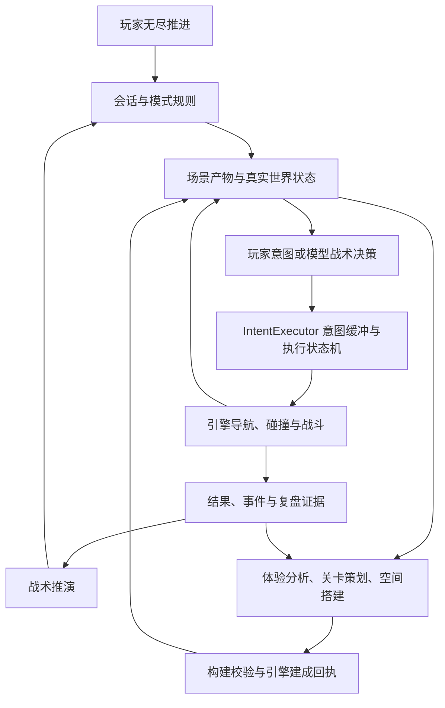

# 玩家无尽推进与战术推演：系统设计及落地路线（设计记录）

当前可运行能力和入口以 [Deskfront 当前版：无尽推进](deskfront-current.md) 为准。本页保留设计目标、未完成项和验收路线，不能把目标描述当作已实现能力。

日期：2026-09-23。状态：设计草案，尚未代表实现或实战验收。

## 2026-10-02 模块化落地状态

第一轮完整模块化已落地并通过回归：HTTP 路由、Deskfront 解说/弹幕、小队上下文/模型/命令/回执/快照、staging 流水线、区域表现、战术策略和世界导演合同均有独立模块；原有公开入口、日志协议和 `IntentExecutor` 边界保持不变。当前仍保留少数兼容外壳（`server.ts`、`human_squad.py`、`stage.py`、`growth.gd`、`tactics.py`、`director.py`），它们负责装配和旧导入兼容，不再是唯一实现位置。

验证范围：TypeScript 类型检查通过；`npm test` 345 项中 338 通过、7 跳过、0 失败；目标 Python 回归及 staged Godot 4.5.1 编辑器加载通过。真实模型请求、长时真人试玩和视觉接受仍需单独报告，不能由模块化回归代替。

## 1. 产品方向与范围

先以 Deskfront 为主线：玩家无尽推进承载持续游玩，战术推演承载战术验证；两者共享场景规格、战斗规则、执行回执和记录格式。QuickPlay 的其他游戏继续使用公共 Harness，暂不同时改造。独立的 `/game/soldiers-endless` 保留为既有实验，不直接合并到 Deskfront。

本阶段的系统化，是把「玩家做什么、系统如何回应、结果如何影响下一步、怎样证明有效」连成闭环。先交付两个可验收的模式，再按实际共性抽取接口。

## 2026-09-28 现状核对：先保护现有效果

结论：底层已有系统边界，但产品层的「玩家无尽推进」尚未闭环。当前 `infinite` 更准确地说是**自动连续生成并战斗的观战/验证模式**。它会依据原生战况准备下一段，却没有可用的玩家小队指挥输入。因此不能因 manifest 声明 `human: true`，就认定玩家已经能连续指挥远征。

| 链路 | 当前事实 | 梳理时的边界 |
|---|---|---|
| 公共 Harness | `src/external/runtime.ts` 统一会话、模型请求、预算、协议、日志和进程生命周期；`src/deskfront/runtime.ts` 注册 Deskfront 的多种变体 | 先整理模式与配置表，不改公共运行器的调度语义 |
| 无尽世界生成 | `world/host.py` 在 Godot 清场且 ready 后调用 `WorldDirector`；分析、JEV 策划、九桌搭建、几何校验、提交和原生建成回执分离 | 保留现有调用顺序、选项和可建造性规则；`queued`、引擎接受、建成、任务完成分别记录 |
| 战斗执行 | 指挥/单兵控制器提出行动，`IntentExecutor` 仅管理意图缓冲及执行状态，Godot 对移动、碰撞、射击、任务和伤亡给出事实 | 不把执行器扩成战术 Agent，也不搬动原生安全反应；新旧控制链先做映射 |
| 玩家操作 | `world/host.py` 的 `infinite` 输入只接受 `pause`，其他动作记录为 `unsupported-infinite-action` | 玩家指挥、AI 托管和控制权切换属于待设计/待实现的 P2；观战样本不能推断玩家偏好 |
| 跨关结果 | `growth.gd` 有原生 `mission_results`、存活/增援摘要、旧区域回收和容量暂停；最近记录是有界窗口 | 用会话日志串起完整远征，不能只靠最近六段内存窗口；异常结束与玩家战败分开 |
| 验证 | 2026-09-29 已将两处旧 `open/books/empty` 模拟回答改为当前卡片＋朝向，并使缺失选项直接报错；旧的三件遮挡、原始物件尺寸和九格全重复假设也已按当前单件/双件卡片规则调整。`deskfront_world_*checks.py` 当前 122 项通过；这仍是无模型/无原生引擎的回归检查 | 继续分别验收受控生成、原生建成、连续战斗和真人体验，不以测试通过代替实战效果 |

现有证据的范围也要固定：`output/curated-generation-live-20260928-r3/report.json` 是五次真实 JEV 受控生成，标注 `native_execution: not_run_by_this_probe`；`test/deskfront-world-harness.test.ts` 的原生集成例默认跳过，即使运行也只验证初段绿色命令被接受。已有后台三段建成记录使用本地 Bot，且早于最后一次历史延续修复。以上都不能替代当前版本的真人三段推进验收。

**不影响现有效果的整理顺序：**

1. 固定基线：记录当前工作区、启动配置、关卡产物、模型原答、合法命令、Godot 回执、战果、帧率/等待和画面。保留现有 `infinite` 默认路径；独立的 `/game/soldiers-endless` 不并入 Deskfront。
2. 做只读链路索引：每个入口对应哪条控制链，哪段代码拥有生成/决策/执行/结算，哪份文档是现行约定。清理过时叙述时先标历史，不移动运行代码；`stage.py` 的临时引擎注入对源码锚点敏感，优先锁定兼容测试。
3. 恢复验证栅栏：现行卡片＋角度模拟回答及卡片几何回归已补齐；继续保持真实模型选择不被 Harness 偷偷改图。下一步验证原生建成回执与一段战斗，不能只看 HTTP 202 或静态几何。
4. 把现有日志投影为 `Session → Encounter → Decision/Intent → Command → NativeReceipt → EncounterResult` 的只读报告。先补关联 ID 和缺失证据标记，不新建第二套状态真相，也不改变模型提示、节奏和动作替换规则。
5. 以现有基线为对照逐项开发 P1/P2：固定推演案例先帮助归因；玩家操作与 AI 授权再单独接入。每一步同场景比较真实移动/射击、伤亡、生成等待、调用量和观感；回退只需切回原入口/配置。

这份核对是源码、现有产物和本轮回归检查的边界说明；没有在本轮启动新的真实模型对局或真人试玩。

## 2. 当前基础与缺口

以下来自当前工作区源码及文档核对；本轮未启动引擎或调用模型。历史测试数量与旧会话结果不作为当前版本验收。

| 范围 | 已有基础 | 本阶段需补齐 |
|---|---|---|
| 模式入口 | `src/deskfront/runtime.ts` 注册 infinite、duel、duel-tactics 等变体 | 将开发变体整理为两个明确的产品入口；后台验证入口单列 |
| 生成 | `world/director.py` 已分离体验分析与关卡准备；策划、搭建、校验和建成回执已有链路 | 固定体验目标、每关结果、失败处理和玩家可见状态之间的合同 |
| 空间 | 区域图、组件拼装、静态射界估计；`world/growth.gd` 已有旧区域回收和容量暂停 | 连续推进的等待、落后队员阻塞、长时间资源边界验收 |
| 战斗控制 | human_squad 与既有 tactics 路径均存在；不能假定已完全统一 | 明确两模式选用的控制链及差异，先统一输入输出，再决定内部收拢 |
| 玩家控制 | Runtime 声明 human 能力；host 存在按模式分支 | 逐项验证实际输入、单位控制权、AI 托管及切换；声明 human 不等于玩家闭环已验收 |
| 推演 | 固定场景、规则验证与模型会话已有基础；manifest 当前声明 seed=false | 场景归档、相同初始条件重跑、方案比较和证据报告 |
| 文档 | 多轮设计和历史证据丰富 | 建立当前规则索引，避免旧预生成、旧兵力和旧控制职责混用 |

当前职责边界以 [意图执行器约定](deskfront-intent-executor.md) 为准；生成链参考 [生成职责](deskfront-generation-agents.md)。这份文档定义目标，不覆盖已确认的执行约定。

## 3. 两个模式的玩法闭环

### 玩家无尽推进

玩家进入遭遇 → 观察并下达操作 → 战斗与推进 → 引擎结算 → 查看损失和进展 → 根据实际结果生成下一段 → 继续或结束远征。

第一版建议采用「玩家小队指挥」：玩家选择目标、路线倾向和进退，AI 在授权范围内承担队内分工和局部行为。直接操控单兵作为后续可选操作方式；该选择属于设计建议，实施前需要确定具体操作体验。

- 玩家目标：带队持续前进，并承担伤亡、弹药或其他实际支持的资源后果。第一版只使用引擎已支持的资源，不为设计表格虚构系统。
- 连续性：存活、伤亡、队伍组成及推进记录跨遭遇保留；补员必须是明确事件，不能隐式复活或恢复。
- 每关一个主要体验目标，例如正面压制下绕侧、突破狭口、短暂恢复；地形和部署必须支持该目标。
- 生成时序第一版沿用已存在的清场后准备链路；不在未验证兵力一致性之前恢复预生成。分别测量分析、策划、搭建、校验、施工及可操作等待。
- 真人表现和 Bot 演示分开。没有操作机会和玩家选择记录时，只能分析战况，不能推断玩家偏好或水平。
- 失败与结束明确区分：全灭、主动结束、生成失败、服务故障、预算耗尽分别记录。预算耗尽不计作玩家战败。
- 区域无法回收时解释阻塞原因；不能靠传送队员、删除活单位或无限堆积地图解决。

### 战术推演

选定场景与问题 → 保存初始条件 → 指定控制方式和方案 → 执行 → 从实际回执复盘 → 改变一个因素重跑 → 比较结果。

第一版聚焦三个问题：正面掩护是否真正帮助推进、侧路是否被实际使用、受阻后能否合理重评。每个问题有一个小场景，避免一开始用复杂全局战斗解释所有行为。

- 保存完整场景产物、部署、装备、规则版本、控制配置、模型标识及预算；支持种子后再加入随机种子，不能只存一个名称。
- 首先提供「重置后重跑」与「按事件查看复盘」；精确逐帧重放、任意时刻回滚和模型确定性另行实现。
- 规则演练用于检查工具与物理；真实模型对战用于评价选择与协作。两者报告分开。
- 采用同场景、同兵力、同预算、同终止条件比较；模型非确定性要求多次运行，单局只作案例。
- 报告同时展示胜负、伤亡、目标进展、有效支援、移动受阻、空等时长、请求数和耗时，不能只优化胜率。

两个模式之间的关键连接：将一场有问题的无尽遭遇保存为推演案例；推演确认的问题修复后，在无尽模式复验。第一版从遭遇开始时重建，不承诺从任意战斗中间帧恢复。

## 4. 共享系统与职责

这是目标职责图。当前已有独立的 `src/deskfront/world/intent_executor.gd`，由 `stage.py` 注入会话引擎副本并在 `human_squads.gd` 使用；它的覆盖范围仍以 [意图执行器约定](deskfront-intent-executor.md) 为准，不能把整张目标图解读成已完成实现。

| 责任 | 归属与边界 |
|---|---|
| 玩法规则 | 模式负责目标、结算和结束原因；任务完成必须使用引擎事实 |
| 内容生成 | 体验分析输出带证据及不确定性的体验报告；策划选遭遇任务；搭建生成可校验空间 |
| 战术决策 | 保留 DeepSeek 区域/阶段、小队 Jev 分工、个人 Jev 局部意图的职责；具体模式的现有实现需逐项映射 |
| 意图执行 | IntentExecutor 仅为意图缓冲区 + 执行状态机；不调用模型或决定战术 |
| 真实执行 | Godot 负责移动、碰撞、射击、安全验证及真实结果 |
| 公共 Harness | 上下文、调度、预算、超时、会话、模型调用与回执传递 |
| 观察与评估 | 统一关联决策、指令、执行事件和结果；不以指令接受代替到位或完成 |

玩家与 AI 的控制权需要按队伍/单位显式记录。切换拥有者时增加控制版本，废弃旧版本的待处理结果；恢复前重新验证当前条件。保留引擎必要安全规则，具体哪些动作可被中断要在实施时列出矩阵。

## 5. 先固定的数据合同

这些是逻辑记录，不要求立刻新建六套服务或数据库。优先复用现有会话与 JSONL 日志。

| 记录 | 最少需要保存什么 |
|---|---|
| Session | 模式、控制来源、配置/代码版本、预算、开始结束时间与结束原因 |
| Encounter | 场景完整产物、目标、初始单位状态、地图版本、生成依据与建成回执 |
| PlayerIntent | 玩家输入、控制对象、授权范围、控制版本；与模型决定分别标记 |
| TacticalPlan | 阶段目标、分工、有效条件、对应任务版本和重评原因 |
| ExecutionEvent | 指令 ID、来源、接受/执行/挂起/恢复/完成/失败/取消、引擎时间、实际原因 |
| EncounterResult | 是否完成、双方损失、耗时、路径与交火摘要、操作来源、缺失证据 |

所有记录通过 session、encounter、任务版本和 operation/intent ID 关联。跨区域、跨控制权及跨会话的迟到结果必须可追查并被拒绝。

## 6. 实施顺序与验收门槛

| 阶段 | 交付物 | 完成条件 |
|---|---|---|
| P0：现状收拢 | 两模式配置表、控制链映射、当前规则索引、基线会话 | 每项规则能指向源码；真人/模型/规则来源可辨；两模式各有真实引擎基线，失败如实记录 |
| P1：推演最小闭环 | 三个固定案例、初始条件归档、重跑入口、事件报告 | 可复现初始条件；接受与完成可区分；三个战术问题均能找到对应引擎证据；不要求先证明模型一定成功 |
| P2：玩家推进闭环 | 明确操作方式、控制权切换、遭遇结算、连续生成、结束说明 | 真人连续完成至少三场遭遇；损失/存活状态正确延续；暂停、切换、迟到回复不造成控制冲突；失败可诊断 |
| P3：模式互通 | 无尽遭遇导出为推演案例、修复后回归 | 从保存产物重建相同初始场景；能关联原会话并对比关键事件 |
| P4：质量与长时运行 | 多场景重复评估、资源与延迟报告、生成体验分析 | 建议先做30段离线链路与60分钟实机稳定性验证；资源占用不持续无界增长；真人体验与真实模型效果单列 |

P1 先于扩大无尽内容：有了可复现的战术小场景，才能区分地形、决策、执行和表现问题。P2 的玩家操作设计可与 P1 的合同整理同步推进。上述场数和时长是首轮建议门槛，不是已完成记录或永久指标。

真实模型验收在执行前确定场景、次数与请求预算；报告包含失败样本和实际费用/用量。性能目标先测基线再定，不先承诺零等待、稳定胜率或长期无限运行。

## 7. 本轮决策与下一步

本轮只形成设计与路线，不改玩法逻辑，不启动模型实验。

建议下一轮落地 P0 + P1：把三个固定推演问题、模式配置、初始场景归档和真实回执报告做成第一批可用产物。随后以这些执行能力承接玩家无尽推进。

进入 P2 前需最终确定玩家操作方式（小队指挥或直接单兵操控）、AI 托管范围以及补员/失败后重开的规则。当前草案以小队指挥为推荐默认；不将这项建议当作用户已确认的产品决定。
