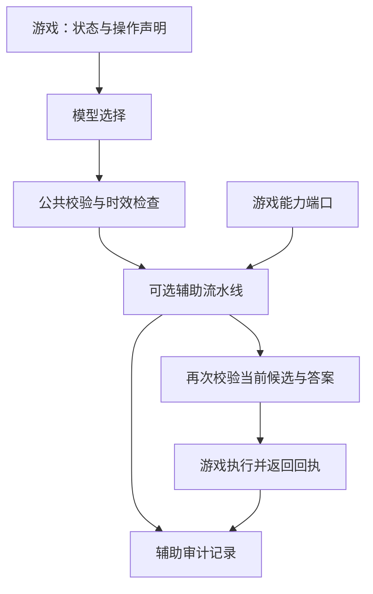

# 最小适配与公共辅助工具

目标：游戏负责状态、可用操作、执行与胜负；Harness 负责请求、时效、日志和可选辅助。默认不增加自动瞄准、寻路或游戏战术。

## 已实现的入口

- `src/arena/minimal.ts`：`createMinimalTurnGame` / `createMinimalRealtimeGame` 返回现有 GamePlugin 所需的游戏对象，继续使用公共 runner，不创建第二套模型循环。
- `src/arena/assistance.ts`：按能力声明的辅助流水线，两个内置工具为图寻路、无进展后的候选替换。
- `src/games/minimal-examples.ts`：推箱子逐格按键、拳击定时按键，绑定已有游戏引擎；共享同一个恢复工具。
- `src/minimal-demo.ts`：两游戏离线可运行示例；生成原始回答、实际动作、辅助介入和结果记录。

```powershell
npx tsx src/minimal-demo.ts
npx tsx src/minimal-demo.ts --recovery
```

固定使用 mock，无需密钥、不调用付费模型。拳击只跑 120 帧用于验证接入，tick-limit 不是获胜。日志写在 `logs/minimal-*`。

## 最少需要游戏提供什么

```ts
const game = createMinimalTurnGame({
  id: 'my-game',
  instructions: '到达终点。',
  initial: () => engine.reset(),
  inspect: state => ({
    observation: engine.observe(state),
    actions: { left: '左移一步', right: '右移一步' },
    outcome: engine.result(state), // null / won / lost / draw
  }),
  execute: (state, action) => engine.execute(state, action),
  // execute 返回 { state, accepted, reason? }，由引擎给出真实回执。
});
```

元数据之外，只写 `initial / inspect / execute`。实时游戏额外提供 `tickMs / actionTicks / step / release`；复活或阶段变化的游戏提供 `contextKey`。动作租期由 Harness 管理，等待新请求不无限维持旧按键。release 只释放输入，不必打断引擎正在结算的攻击动画。

`inspect.effect` 是可选的进展数值和位置签名。没有证据时反馈为 unknown，不猜测胜负或卡住。需要恢复辅助时游戏应声明有意义的 effect。位置签名不要包含每帧递增的时间，否则无法发现原地卡住。

## 辅助怎样通用

工具通过 `DecisionHooks.assistance` 接到公共回合/实时运行器；实时对手侧同样支持。最小适配器把自己的 assistance 自动接过去。



配置示例：

```ts
assistance: {
  tools: [createStallRecoveryAssist(3)],
  ports: state => ({
    alternatives: { question: 'action', choices: engine.legalActions(state) }
  })
}
```

不提供 assistance 或 tools 为空即关闭，工具按配置顺序运行，后一个看到前一个校验通过的输出。没有隐藏的自动工具选择。

| 工具 | 游戏提供的能力 | 公共实现负责 |
|---|---|---|
| `navigation.shortest-path/v1` | start、goal、neighbors，以及边对应的动作名 | 有节点预算的无权图 BFS，返回最短路径第一步；不可达则不干预 |
| `recovery.alternative/v1` | 进展/位置反馈及有序替代动作列表 | 达到无进展次数后，尝试不同于当前选择的第一个候选 |

寻路不判断目标的战术价值，也不假设格子、房间或坐标单位；游戏提供图。把跳跃物理变成可达边、选择打哪个敌人，仍需要相应游戏能力。网格和命名房间图已用同一个工具验证；尚未将旧跳跃辅助控制器迁入它。

恢复不保证新动作更好；它只提供可重复、可检查的替换机制。游戏声明的候选顺序仍会影响结果。薄适配的拳击实验使用 advance/retreat 作为明确的替代列表。

## 审计和失败行为

- `execution.rawAnswers`：原始模型回答，保持不变。
- `execution.assistance[]`：工具 ID、状态、原因、before/after。状态为 applied/skipped/rejected/error；这里 applied 仅指工具输出被采纳，不代表引擎接受或游戏进展。
- `execution.executedAnswers / action`：最终交给游戏的答案与引擎动作回执。
- 工具输出的 one-hot 数值是确定性控制器编码，不是模型信心；应通过 rawAnswers 分析模型概率。
- 工具无法通过输出附带题外 control，不能提交非法候选或坏概率。缺少能力、工具异常或非法输出时保留此前已校验的答案。
- 助手是可信的进程内同步代码，不是执行不可信插件的安全沙箱。能力端口应只读，耗时计算应受预算限制；默认寻路最多探索 1024 个节点。
- 人类直接输入不经过模型辅助流水线；原有游戏的 recover 先执行，工具再执行。旧 recover 未自动迁移，日志的原始/执行答案仍可检查其效果。

## 当前边界

这是可以运行和复用的第一版，不是所有旧游戏已完成迁移。原有大厅的四款游戏保留原默认适配、前端和玩法；薄适配示例使用 CLI 运行，尚未提供大厅切换按钮。直接把现有插件切换到最小包装状态需要同步适配其前端观察数据。

工作区已有的 `quickplay-game/v1` + Python/JavaScript SDK 继续作为外部游戏接入方式。公共辅助当前接入 TypeScript 内置回合/实时 runner；外部协议没有新增可跨进程调用的能力端口，因此不能声称 Python/Deskfront 已自动获得这些工具。

后续扩展可沿同一能力端口增加瞄准或路线跟随，再接入外部协议；不要把某款游戏的坐标、武器规则或解法写死进公共工具。
