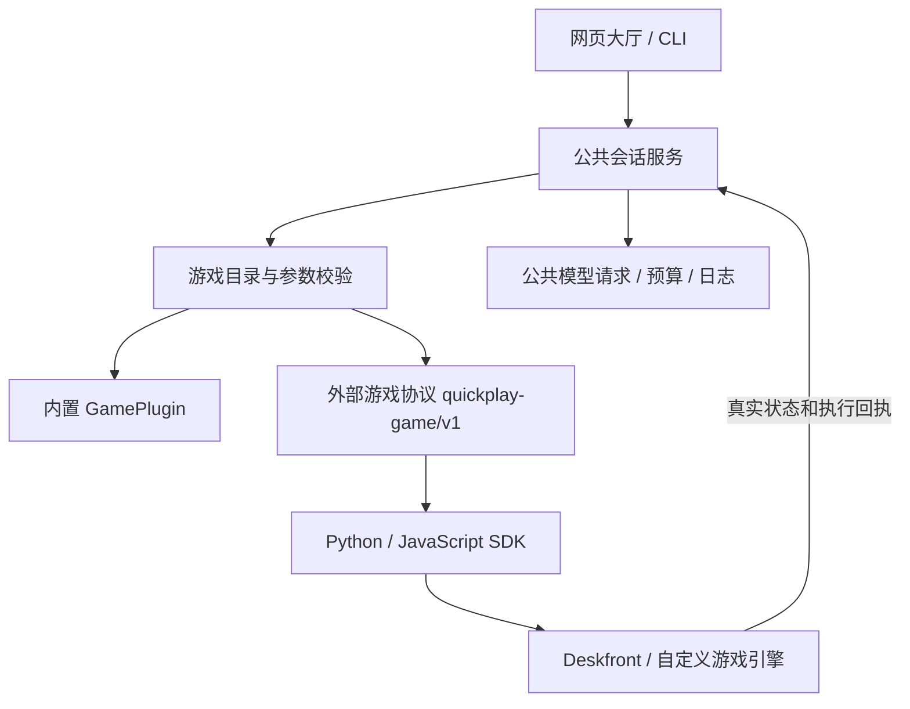

# 统一 Harness：外部游戏接入说明

目标是让游戏只提供规则、观测、候选动作和执行回执。注册、启动、模型选择、请求校验、超时、预算、取消、状态查询、日志和停止由同一个 Harness 提供。

新增外部游戏的默认接入方式是 **`quickplay-game/v1` + SDK + `game.json`**。不需要修改网页服务、模型后端或公共对局服务。Deskfront 和最小计数游戏都走这套协议。



## 最快验证路径

在 Harness 根目录执行：

```powershell
npm run jev -- register examples/counter/game.json
npm run jev -- list
npm run play -- counter-demo --backend mock
npm run serve
```

重启网页服务后，大厅自动出现“最小接入示例”，参数表单来自清单。测试用 mock，不调用付费模型。示例包含完整的请求、模型回答、游戏实际执行和胜负结算。

注册信息保存在忽略提交的 `games.local.json`。重复注册同一路径不会产生重复项。需要移除时从其 `manifests` 数组删除对应路径。服务启动时加载清单；注册新游戏后重启服务。可用 `QUICKPLAY_GAMES_CONFIG` 指定另一份清单。

## 一个游戏需要提供什么

| 文件/能力 | 游戏作者负责 | Harness 负责 |
|---|---|---|
| `game.json` | 名称、启动命令、能力、变体、参数约束 | 注册、目录、参数校验、通用页面 |
| SDK 适配代码 | 读取实际游戏状态、构造候选动作、调用引擎 | 消息传输、请求关联、停止信号 |
| 模型决策 | 定义问题与合法动作 | 选择模型、回答校验、超时、请求预算、并发隔离 |
| 执行回执 | 判断引擎是否接受以及实际效果 | 保存原始回答和游戏回执，统一查询与导出 |
| 游戏子进程 | 停止时释放自己的引擎/资源 | 生命周期管理、停止请求、超时清理 |

Python SDK 是 `sdk/python/quickplay.py`，仅依赖标准库。可复制到游戏项目，或把其目录加入 `PYTHONPATH`。JavaScript SDK 是 `sdk/javascript/quickplay.mjs`，同样仅依赖 Node 标准库。其他语言直接实现同一份 NDJSON 协议即可。

最小 Python 用法：

```python
from quickplay import Game

game = Game()  # 接收配置，完成握手
state = {"position": 0}
game.publish(state)
reply = game.ask(state, {
    "move": {"type": "choice", "instructions": "前进一步",
             "criteria": {"advance": "前进"}}
})
# 在这里调用真实引擎，并读取其回执。
# reply['requestId'] 用于关联这次决策；返回模型答案本身不代表执行成功。
game.record({"requestId": reply["requestId"], "receipt": {"accepted": True}})
game.finish("won")  # 仅在游戏自己的胜负规则确认获胜后发送
```

上面两处回执/胜负是接口示意；可运行示例见 `examples/counter/game.py`，其结果由实际计数规则产生。独立于引擎的网页或控制器不能代替引擎宣布成功。

JavaScript 使用 `const game = await Game.connect()`，随后同样调用 `publish`、`ask`、`record`、`finish`；监听 `input`、`action` 和 `stop` 事件。Python 使用 `game.inputs` 队列和 `game.stopped` 事件。所有调试输出写 stderr，stdout 专供协议。

## 清单与每局配置

清单的机器可读定义见 [game-manifest.schema.json](game-manifest.schema.json)。示例：

```json
{
  "protocol": "quickplay-game/v1",
  "id": "my-game",
  "name": "我的游戏",
  "description": "游戏说明",
  "command": ["python", "game.py"],
  "capabilities": { "human": false, "ai": true, "seed": false },
  "options": {
    "target": { "type": "integer", "default": 4, "min": 1, "max": 20 }
  }
}
```

`cwd` 默认是清单所在目录。`command` 是程序与参数数组，不通过 shell 拼接。可声明 `variants`、`maxSessions`、`startupTimeoutMs` 和游戏需要的 `env`。模型密钥只在 Harness 中解析，不通过配置或默认子进程环境下发给游戏。

每局启动配置共用以下结构：

```json
{
  "backend": "mock",
  "mode": "ai",
  "gameOptions": { "target": 6 },
  "runtime": { "requestTimeoutMs": 10000, "maxRequests": 100, "durationMs": 60000 }
}
```

通用参数放 `runtime`；游戏参数放 `gameOptions`，由清单约束类型、范围、枚举和默认值。未知参数会报错。`variant` 和 `seed` 必须符合游戏声明。内置回合游戏额外支持 `maxTurns`，内置实时游戏支持 `maxTicks` 和 `decisionMs`；外部引擎自己的帧/回合上限应定义为游戏参数，不假定不同引擎使用相同时钟。

网页、CLI、评测共用模型解析器。显式选择 mock 永远走离线后端；付费后端可使用 `config.local.json` 保存的模型配置，没有保存配置时使用环境变量。CLI 默认尊重 `SYSTEMONE_BACKEND`，否则使用保存的默认模型，没有配置则使用 mock。`bench` 仍默认 mock；离线预览也仍固定 mock。

## 对外接口

| 请求 | 用途 |
|---|---|
| `GET /api/games` | 游戏目录、能力、变体、参数定义 |
| `GET /api/backends` | 可选后端名称与默认后端，不包含密钥 |
| `POST /api/match/{gameId}` | 以统一配置启动，返回 `matchId` |
| `GET /api/match/{matchId}/state` | 公共状态；`latest.observation` 为游戏观测 |
| `POST /api/match/{matchId}/input` | 玩家输入，仅支持该能力的游戏可调用 |
| `POST /api/match/{matchId}/action` | 游戏操作，例如无尽模式下一关 |
| `POST /api/match/{matchId}/stop` | 请求停止并取消模型等待 |
| `GET /api/match/{matchId}/history` | 回答、游戏记录与执行回执 |

当前服务是本机入口，默认监听 `127.0.0.1`。可对外分发 SDK 和接入契约；这次没有部署多租户公网服务或加入用户鉴权。命令注册由本机操作者完成，HTTP 启动接口不接受任意 shell 命令。

进程内接口是 `createSessionService()` 的 `catalog/start/state/input/action/stop/history/wait/close`。`stop` 表示停止已发起；`wait`/`close` 等待托管进程退出和结算日志完成。

## Deskfront 接入

默认发现相邻的 `../deskfront-jevlab`；也可设置 `DESKFRONT_ROOT`。Python/Godot 路径通过 `PYTHON_BIN`、`GODOT_BIN` 覆盖。在当前 Windows 开发目录还能发现相邻 `.artifacts/godot-4.5.1` 下的引擎。

```powershell
npm run play -- deskfront --variant headless --backend mock --duration-ms 15000
```

大厅可选原生窗口或后台验证，以及模型/玩家控制。适配器使用独立端口、独立日志和自有 Godot 进程；模型请求通过 SDK 交给 Harness。它复用 Deskfront 的候选动作与控制器，把真实 Godot 状态和回执返回公共服务。没有改写现有 Godot/Python 工程，也不加载其 `.env`。自然语言关卡创作仍属于原 Deskfront 应用，不混入战斗接入契约。

可重复运行真实引擎验收（离线测试后端）：

```powershell
$env:DESKFRONT_LIVE_TEST='1'
node --import tsx --test test/deskfront-runtime.test.ts
```

这项测试要求真实 Godot 状态、模型请求经过公共后端、至少一条指令获得 Godot 接受回执，并验证停止收尾。它不证明真实付费模型效果或 Web 导出版本验收。

## 兼容边界

四款原有内置游戏保留 `GamePlugin`，通过同一个会话服务运行；评测共享配置校验和运行装配，保留离线加速与指标汇总。玩具兵无尽模式已进入公共会话目录，旧 `/api/endless` 只是兼容路由。旧 JGP 命令 `jev run -- <command>` 仍可用，由兼容适配器接入公共会话服务。

新外部游戏统一使用 `quickplay-game/v1`；无需模仿旧 JGP 的玩具兵世界结构，也无需复制 Deskfront 的 HTTP 接口。各引擎保留自己的物理、单位、路径和画面，只通过统一契约交换观测、问题、回答和回执。
